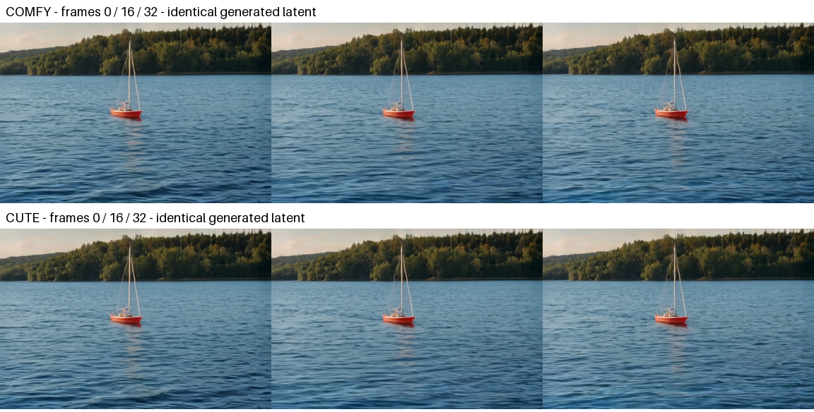

# LTX 2.5 3D neighborhood attention — RTX 5090

The dedicated CuTe decode node successfully runs LTX 2.5's diffusion video VAE.
The supplied workflow generated a 384×256, 33-frame video with all 24 neighborhood
blocks using CuTe. Regular and tiled decodes agree with current ComfyUI at about
62 dB PSNR. **CuTe is slower on this measured workload:** warm complete decoding
takes 270 ms versus 166 ms with ComfyUI's native CUDA neighborhood kernel.

[UI workflow](../workflows/ltx25-neighborhood-3d.json)
· [API workflow](../workflows/ltx25-neighborhood-3d-api.json)
· [Sanitized measurements](ltx25-na3d-2026-11-13.json)



## Environment and provenance

- Vast.ai RTX 5090, SM 12.0, 32 GB (32607 MiB reported), 400 W power limit;
  NVIDIA driver 610.57.04. The test instance was destroyed after the captures
  were archived and their hashes verified.
- Python 3.13.18, Torch 2.13.0+cu130, CUDA 13.0, Triton 3.7.1,
  CUTLASS DSL 4.8.1 with CUDA 13 libraries, TVM FFI 0.1.15.post0.
- ComfyUI `35060f0156181ae78a86b10f098f67ce8e83697f`, comfy-kitchen 0.2.40.
- Vendored KohakuFA-CuTe `cf97ce0e204f0ba970b04dcd5af5ad7d5c6e560d`;
  existing namespace and native-launcher adaptations retained.
- Lightricks/LTX-2.5 weights at `49b093a39c19169a8a81721dcc541e07e945232f`.
  All four downloaded files were SHA256-verified against their LFS metadata.
  File hashes and exact tested integration source hashes are in the measurements.
- Workflow derived from the first stage of Comfy-Org's
  [template](https://github.com/Comfy-Org/workflow_templates/blob/e7cd011d4ded3411c2f481200544f0be6fdc962e/templates/video_ltx2_5_t2v.json).
  It retains the eight-step distilled sigma schedule and CFG 1/1, uses seed 1729,
  and omits prompt enhancement and second-stage upscaling. MIT attribution is
  retained in `NOTICE` and `LICENSES/MIT-Comfy-Org.txt`.

ComfyUI's `na_diffusion_decoder.py` still calls this an LTX 2.4 architecture, but
it loads the LTX 2.5 diffusion VAE. Its current call is `comfy_kitchen.na3d`, with
NATTEN-compatible shifted boundary windows. The reference run here is the
current kitchen CUDA implementation. A separate untimed profiler replay recorded
`na3d_kernel` for ComfyUI and the vendored `NeighborhoodAttention` kernel for CuTe.
It is not the older Python tile/mask/SDPA helper used in upstream's H100 report.
Upstream's compact volume optimization is H100-specific; 5090 dispatches to the
generic 3D owner. No kernel tuning or arithmetic changes were made locally.

## Complete decoder comparison

Both backends decode the same saved generated latent, `[1,128,5,8,12]`, using
the same BF16 VAE and ComfyUI's fixed decoder noise seed. Q/K/V retain BF16 and
`[B,T,H,W,heads,64]` layout; `scale=1.0` preserves the decoder's already-scaled Q.
The surrounding projections, RMS normalization, RoPE and residuals are unchanged.

| Decode mode | CuTe calls | Mean absolute pixel difference | PSNR |
| --- | ---: | ---: | ---: |
| Regular | 24 | 0.000495 | 61.99 dB |
| Tiled | 96 | 0.000495 | 62.16 dB |

Pixels are measured before PNG/video encoding, in ComfyUI's `[0,1]` IMAGE range.
Both pass the predeclared MAE ≤ 2/255 and PSNR ≥ 35 dB gates. Maximum absolute
differences are 0.00684 regular and 0.00610 tiled. Temporary block forwards were
checked for exact restoration after every decode. This is one prompt and seed,
not a general perceptual-quality qualification or bitwise-equivalence claim.

Regular complete-node timings use CUDA-synchronized wall time, one excluded
first call per backend, then three warm runs in alternating order. Weights are
resident for warm runs; the boundary includes projections, normalization, RoPE,
all decoder stages, node wrapping and output transfer, not just attention.
On-disk kernel caches had been populated by earlier validation. First-call times
include model loading/preparation or kernel compilation and are separate below.

| Backend | First call | Warm samples | Warm median |
| --- | ---: | --- | ---: |
| ComfyUI CUDA | 471 ms | 164.5, 166.4, 166.0 ms | 166.0 ms |
| CuTe 3D | 7447 ms | 269.7, 270.3, 273.1 ms | 270.3 ms |

CuTe is approximately 63% slower for this small decoder workload. Both measured
2.38 GiB peak Torch allocated memory during regular decoding. Tiled checks used
tile size 256, overlap 64, temporal size 24 and temporal overlap 8; only one
correctness run per backend was performed, so their first-call durations are
not steady-state performance results.

The full ComfyUI HTTP queue completed and saved both MP4 and latent outputs.
The final request took 69.2 seconds including model preparation and first-use
work; this is execution evidence, not a paired end-to-end speed comparison.
The MP4 is retained in the external capture archive. The published metadata-free
PNG comparison sheet contains
unscaled frames from regular decoding with labels added.

Actual regular-decode attention shapes (batch 1, head dimension 64, BF16):

| T×H×W | Heads | Requested window | Blocks |
| --- | ---: | --- | ---: |
| 7×8×12 | 32 | 3×7×7 | 4 |
| 7×16×24 | 16 | 3×7×7 | 6 |
| 13×16×24 | 8 | 3×5×5 | 4 |
| 25×32×48 | 8 | 3×5×5 | 2 |
| 33×64×96 | 4 | 11×11×11 | 8 |

## Validation

- 71 CPU tests passed, including 26 privacy guard tests and seven new LTX
  integration tests: layout/clipping, unsupported contracts, CPU fallback,
  thread isolation, exception restoration, compiled/modified-forward rejection,
  regular/tiled delegation and rejection of executions with zero attention calls.
- The publication guard validates the prepared RGB PNG's structure, CRCs and
  bounded decompressed pixels, rather than interpreting compressed pixels as
  text. Ancillary metadata, trailing data and malformed images are rejected;
  staged/history checks and strict text scanning remain active. The visible
  comparison image was reviewed separately. This support does not allow arbitrary
  binary files or video through the guard.
- Eight FP16/BF16 3D CUDA cases passed independent per-head FP64 gates for output
  and all three gradients. Cases cover temporal seams, strided operands, even and
  clipped windows, single-frame volumes, positive, negative and zero scales.
- Real comfy-kitchen comparison passed in FP16/BF16. CUDA FP32 auto fallback
  exactly matched kitchen; strict CuTe rejected FP32 without conversion.
- Dense CUDA regression: five passed, four RTX 4090-specific tests skipped on
  the 5090. Existing 2D neighborhood regression: three passed. These include real
  ComfyUI model-patcher integration and output/gradient checks.
- Wheel and source distribution built; package contents include the new node,
  both new upstream modules and the workflow license. UI/API graph connections
  were checked for correspondence. The API graph was actually executed through
  ComfyUI; no browser/UI automation was used.

Worst per-head FP64 relative norm errors across the eight operator cases:

| Dtype | Output | dQ | dK | dV |
| --- | ---: | ---: | ---: | ---: |
| FP16 | 0.0276% | 0.0274% | 0.0313% | 0.0364% |
| BF16 | 0.1870% | 0.2267% | 0.2539% | 0.2696% |

The independent limits were 0.5% FP16 and 1% BF16 for each head/component.
NATTEN was not needed or installed for this LTX test. Full-model FP16, HDR/FP32
quality, larger videos, other GPUs and compiled decoders are outside this run's
qualification scope. No inference from the earlier PMRF/4090 results is made.

## Reproduce

Install the repository and CUDA dependencies in the supported ComfyUI environment,
download the four model files listed in `README.md`, then load the UI workflow or
submit the API JSON to ComfyUI's prompt queue. Start ComfyUI with `--bf16-vae`.
The workflow saves `latents/ltx25-cute-na3d_00001_.latent` under its output directory.
From this extension's directory, use ComfyUI's Python environment:

```sh
python -m unittest tests.test_ltx_node tests.test_public_text -v
python -m tests.gpu_neighborhood_3d
python -m tests.gpu_validation --comfyui-root "$COMFYUI_ROOT"
python -m tests.ltx_decode_smoke \
  --comfyui-root "$COMFYUI_ROOT" \
  --latent "$CAPTURE_DIR/latents/ltx25-cute-na3d_00001_.latent" \
  --output "$CAPTURE_DIR/decode" --repeats 3
```

Set the variables to your installation and capture directories, with captures
outside the tracked repository. Raw logs, model outputs, source snapshots and
metadata were retained off-host in a verified 186-file archive; only reviewed
measurements and prepared demo artifacts are published here.
