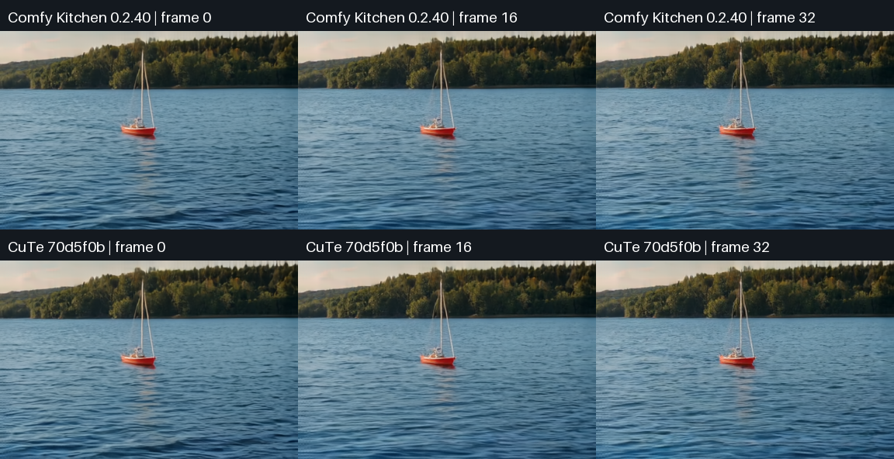

# LTX 2.5 VAE: RTX 5090 performance refresh

KohakuFA-CuTe `70d5f0bff4c6c22b044611b6c44312e6bb1a016f` adds direct
neighborhood-union traversal and cached native launches. The updated node now
decodes the example video faster than Comfy Kitchen. This supersedes the
[previous performance result](ltx25-na3d-2026-11-13.md), which used the generic
3D implementation on the RTX 5090.

[UI workflow](../workflows/ltx25-neighborhood-3d.json)
· [API workflow](../workflows/ltx25-neighborhood-3d-api.json)
· [Measurements and tested source hashes](ltx25-na3d-2026-11-14.json)



## Complete decoder

The same saved generated latent, `[1,128,5,8,12]`, produces a 384×256, 33-frame
video. All 24 neighborhood blocks execute CuTe in strict mode, preserving BF16,
the original Q/K/V layout and `scale=1.0`. The regular decode timing includes
the entire decode node: projections, normalization, RoPE, convolutions, residuals,
attention, node wrapping and output transfer. It excludes video encoding and
diffusion sampling.

| Kitchen version | CuTe median | Kitchen median | Complete-decode speedup |
| --- | ---: | ---: | ---: |
| 0.2.40 | 126.91 ms | 170.61 ms | 1.34× |
| 0.2.41 | 131.99 ms | 170.30 ms | 1.29× |

Each row is the median of seven CUDA-synchronized warm wall-clock measurements.
Backend order alternates. One first call per backend is excluded; weights remain
resident during warm measurements. Both implementations ran sequentially on the
same rental, using identical model weights and input. The old CuTe snapshot
measured 252.57 ms, versus 126.91 ms for the update (1.99×). Its paired Kitchen
samples ranged from 168.29 to 188.70 ms, so raw samples are retained rather than
treating these sequential runs as noise-free hardware comparisons.

First regular calls took 75.51 s for new CuTe and 1.01 s for Kitchen 0.2.40;
44.33 s and 1.03 s respectively in the 0.2.41 run. The old CuTe first call took
16.58 s. These include model preparation and/or compilation, with partially
populated on-disk caches from preceding tests; they are not comparable cold-start
benchmarks. First-use compilation remains substantial and is excluded from the
warm performance claim.

Correctness compares pixels before encoding in ComfyUI's `[0,1]` IMAGE range.
The predeclared gates are MAE ≤ 2/255 and PSNR ≥ 35 dB. Temporary block forwards
were checked for exact restoration after every execution.

| Kitchen version | Decode mode | Mean absolute difference | PSNR | Maximum difference |
| --- | --- | ---: | ---: | ---: |
| 0.2.40 | Regular | 0.000495 | 61.98 dB | 0.00684 |
| 0.2.40 | Tiled | 0.000496 | 62.13 dB | 0.00781 |
| 0.2.41 | Regular | 0.000495 | 61.98 dB | 0.00684 |
| 0.2.41 | Tiled | 0.000496 | 62.13 dB | 0.00781 |

Tiled correctness uses spatial tile size 256, overlap 64, temporal size 24 and
temporal overlap 8. Each tiled decode executes 96 CuTe calls. Only one tiled
execution per backend was measured; these are not warm tiled performance results.
Regular peak Torch allocation was 2.38 GiB for both backends. This remains one
prompt and seed, not a broad perceptual-quality qualification.

## Attention calls

The separate operator benchmark uses synthetic operands on the five observed
decoder shapes, one larger comparison shape and one odd-width boundary case.
Batch is 1, head dimension 64, scale 1.0, with normalized Q and K of norms 1 and
8. The table shows BF16; FP16 and all samples are also in the JSON.

| T×H×W | Heads | Window | CuTe ms | Kitchen 0.2.41 ms | Speedup vs 0.2.41 | Speedup vs 0.2.40 |
| --- | ---: | --- | ---: | ---: | ---: | ---: |
| 7×8×12 | 32 | 3×7×7 | 0.107 | 0.140 | 1.30× | 1.45× |
| 7×16×24 | 16 | 3×7×7 | 0.120 | 0.167 | 1.39× | 1.40× |
| 13×16×24 | 8 | 3×5×5 | 0.101 | 0.132 | 1.30× | 1.34× |
| 25×32×48 | 8 | 3×5×5 | 0.250 | 0.543 | 2.17× | 2.33× |
| 33×64×96 | 4 | 11×11×11 | 5.184 | 9.786 | 1.89× | 2.01× |
| 17×128×128 | 4 | 11×11×11 | 7.090 | 13.543 | 1.91× | 2.02× |
| 13×64×65 | 2 | 11×11×11 | 0.801 | 1.637 | 2.04× | 2.27× |

Three warm calls precede nine alternating measurement samples of at least
200 ms each. Timings include the complete public eager call, output allocation,
layout adaptation and synchronization after every call. Compilation and the
FP64 reference calculation are excluded. These are attention-call speedups,
not complete video-generation speedups. Small-shape results depend strongly on
host launch overhead and this measurement boundary.

Both backends pass independent sampled FP64 checks on the same rounded inputs:
32 seeded random queries plus corners and temporal plane seams, with per-head
relative L2 limits of 0.5% FP16 and 1% BF16. A separate untimed profiler check
confirms the Kitchen CUDA kernel and CuTe union traversal on the large-window
shape; the baseline is not the older Python tile/mask/SDPA implementation.

## Environment and validation

- Vast.ai RTX 5090, SM 12.0, 170 SMs, 32607 MiB, 575 W power limit;
  driver 610.57.04. No power or clock settings were changed.
- Python 3.13.18, Torch 2.13.0+cu130, CUDA 13.0, Triton 3.7.1,
  CUTLASS DSL 4.8.1 with CUDA 13 libraries, TVM FFI 0.1.15.post0.
- ComfyUI `35060f0156181ae78a86b10f098f67ce8e83697f` with comfy-kitchen
  0.2.40, then 0.2.41. The latter is also used in the
  [upstream report](https://github.com/SimpleTuner-io/KohakuFA-CuTe/blob/70d5f0bff4c6c22b044611b6c44312e6bb1a016f/docs/neighborhood/reports/comfy-kitchen-3d.md).
- New upstream source is the fetched `perf/neighborhood-comfy-kitchen` branch at
  `70d5f0b`; the previous vendor is `cf97ce0`. All 62 upstream package files
  remain included, with only the documented namespace/import/launcher adaptations.
- Lightricks/LTX-2.5 model revision
  `49b093a39c19169a8a81721dcc541e07e945232f`; the video VAE download was
  SHA256-verified. The input latent comes from the previously executed eight-step,
  seed-1729 workflow. This refresh replays its decoder portion through the real
  ComfyUI HTTP queue and saves a video; diffusion sampling was not repeated.
- Four 3D CUDA tests pass: eight FP16/BF16 output/gradient cases against FP64;
  Kitchen comparison and FP32 fallback; native-versus-Python launch equivalence
  with fresh tensors, different alignments and scales; union dispatch and CUDA
  graph replay with changed inputs, including odd-width tails.
- Dense CUDA regression: five passed and four RTX 4090-specific checks skipped.
  Three existing 2D CUDA regression tests passed. NATTEN was not needed.
- All 71 CPU tests passed, including 26 privacy guard tests. Formatting, wheel
  and source-distribution builds passed. The prepared metadata-free comparison
  PNG was visually reviewed and checked by the publication guard.

Raw logs, package inventories, tested source, saved latents and video outputs
were retained outside the repository in a hash-verified 193-file archive. The
rented GPU was destroyed, and its absence from the account instance list was
verified. Only reviewed measurements and the prepared comparison image are
published here.

## Reproduce

Use the installation and model instructions in [README](../README.md), generate
and save a latent with the supplied workflow, and run from this extension's
directory in the ComfyUI Python environment:

```sh
python -m tests.gpu_neighborhood_3d
python -m tests.ltx_decode_smoke \
  --comfyui-root "$COMFYUI_ROOT" \
  --latent "$CAPTURE_DIR/latents/ltx25-cute-na3d_00001_.latent" \
  --output "$CAPTURE_DIR/decode" --repeats 7
python -m tests.benchmark_ltx_neighborhood \
  --output "$CAPTURE_DIR/operator.json" --samples 9 --sample-seconds 0.2
```

Keep captures outside the repository. Repeat the benchmark with comfy-kitchen
0.2.40 and 0.2.41 to reproduce both comparisons. Start the workflow server with
`--bf16-vae`. Other GPUs, larger complete videos, full-model FP16/HDR output and
compiled decoders remain outside this integration run's qualification scope.
